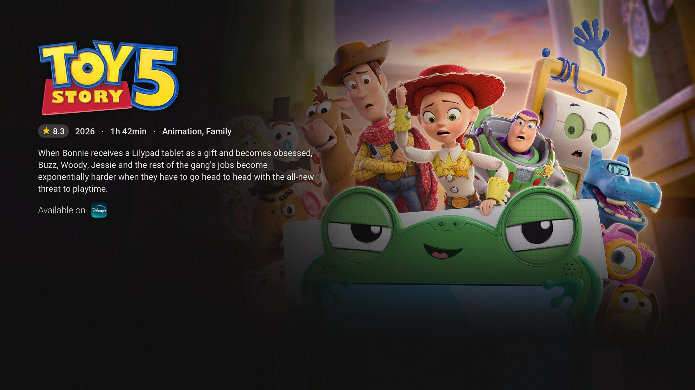
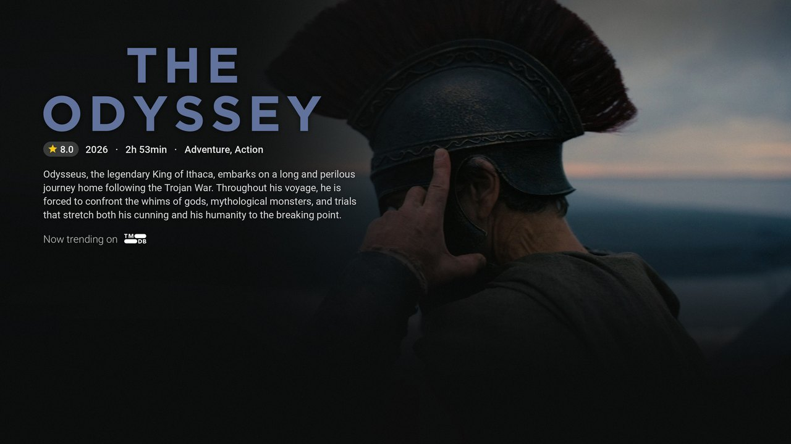
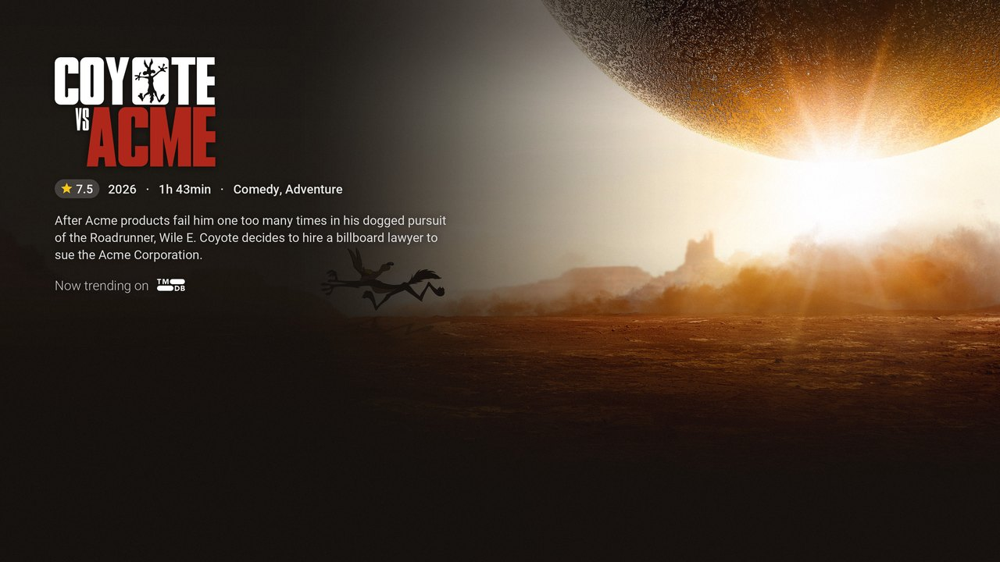
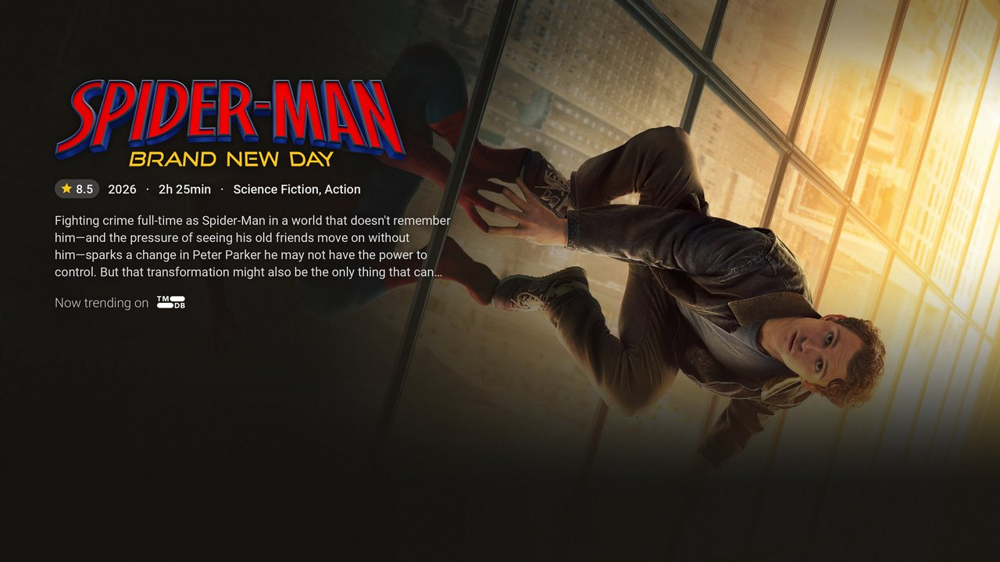
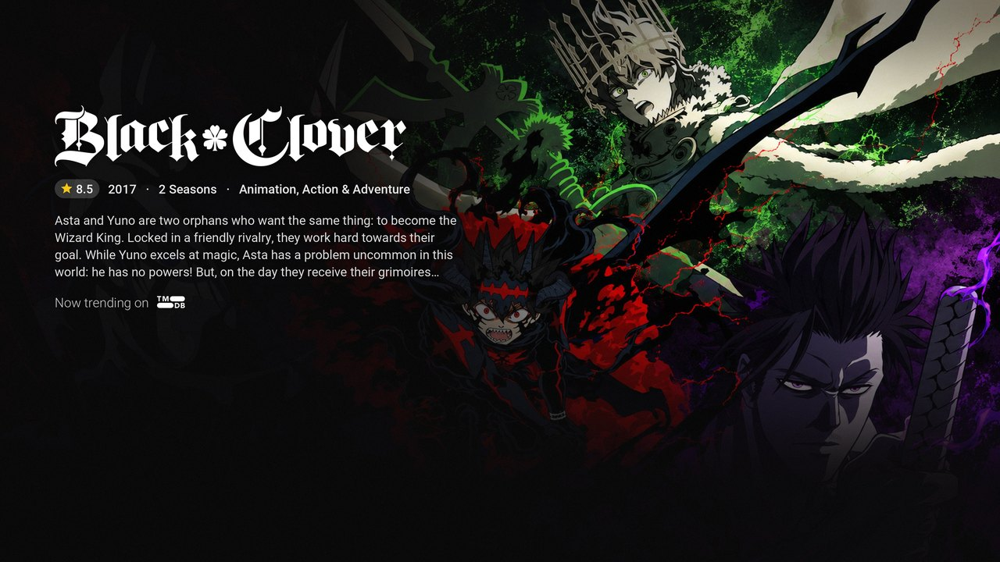
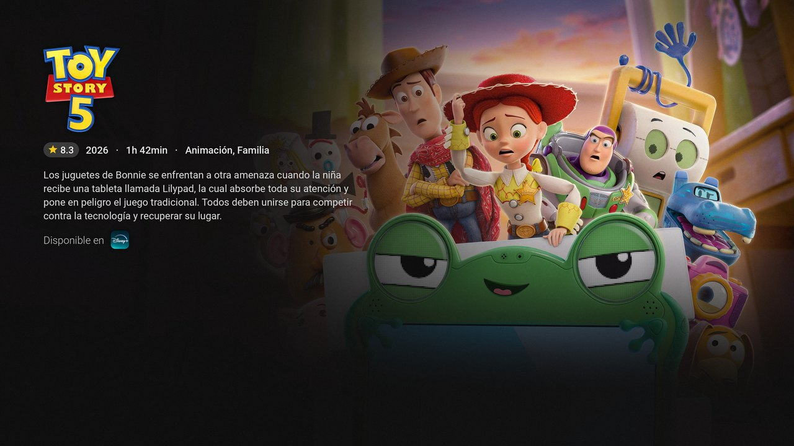
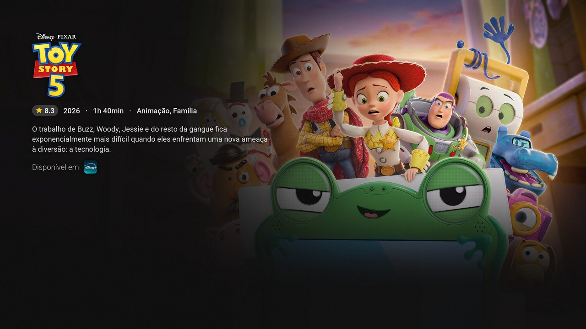

# AndroidTVBackground-Reddit

Automatically generate **4K Android TV wallpapers** from **TMDB trending and popular movies & TV shows**, in several languages, and publish them for dedicated **Reddit subreddits**. Designed as dynamic backgrounds for Android TV launchers such as *Projectivy Launcher*.



---

## ✨ Features

* 🎬 **Trending & popular titles**: 20 movies and 20 TV shows per language, refreshed every week.
* 🖼️ **Full-bleed 4K wallpapers (3840×2160)**: the backdrop fills the screen, with gradients that keep the text readable and leave the lower half free for the launcher rows.
* 🏷️ **Official logos** (or a fitted title when there is none), rating, year, runtime/seasons, genres and synopsis.
* 📺 **Where to watch**: streaming services available in each country, via TMDB's Watch Providers (powered by JustWatch).
* 🌍 **Multi-language**: English, Spanish and Brazilian Portuguese out of the box; any language can be added with environment variables.
* 🎯 **Global hits only**: local-market titles are filtered out unless they are worldwide hits (see [Title selection](#-title-selection)).
* 🤖 **Fully automated** with GitHub Actions every Monday.

---

## 🖼️ Gallery

| | |
|---|---|
|  |  |
|  |  |

The same title in every language (text, logo and streaming services are localized):

| 🇪🇸 Spanish | 🇧🇷 Portuguese (Brazil) |
|---|---|
|  |  |

---

## 📥 Get the Wallpapers

Subreddits:

* 🇺🇸 [`r/AndroidTVWallpapers`](https://www.reddit.com/r/AndroidTVWallpapers) *(English)*
* 🇪🇸 [`r/AndroidTVWallpapersES`](https://www.reddit.com/r/AndroidTVWallpapersES) *(Spanish)*

Or straight from this repository. Every language has a folder with the images and a JSON manifest with the direct URL of each one:

| Language | Images | Manifest |
|---|---|---|
| English (`en-US`) | [`tmdb_backgrounds/en/`](tmdb_backgrounds/en) | [`wallpapers_en.json`](https://raw.githubusercontent.com/rfmarcos/androidtvbackground-reddit/main/wallpapers_en.json) |
| Spanish (`es-ES`) | [`tmdb_backgrounds/es/`](tmdb_backgrounds/es) | [`wallpapers_es.json`](https://raw.githubusercontent.com/rfmarcos/androidtvbackground-reddit/main/wallpapers_es.json) |
| Portuguese (`pt-BR`) | [`tmdb_backgrounds/br/`](tmdb_backgrounds/br) | [`wallpapers_br.json`](https://raw.githubusercontent.com/rfmarcos/androidtvbackground-reddit/main/wallpapers_br.json) |

Manifest format:

```json
[
    {
        "title": "Wallpaper: Toy Story 5",
        "url": "https://raw.githubusercontent.com/rfmarcos/androidtvbackground-reddit/main/tmdb_backgrounds/en/Toy_Story_5.jpg"
    }
]
```

> ⚠️ Each run deletes and regenerates the whole language folder, so image URLs only live until the next weekly update. Download or re-upload the images instead of hot-linking them.

---

## 🧠 How It Works

```
TMDB trending (week) + discover (popular, last 12 months)
        │
        ▼
Merge & deduplicate → filters → weighted ranking → top 20 movies + top 20 TV shows
        │
        ▼
TMDB.py renders a 3840×2160 JPEG per title
        │
        ▼
tmdb_backgrounds/<lang>/*.jpg + wallpapers_<lang>.json committed to main
        │
        ▼
Reddit publication reads the manifest
```

### 🕒 Automatic updates

The [`Generate Wallpapers and Commit`](.github/workflows/upload_wallpapers.yml) workflow runs **every Monday at 09:00 UTC** (and on demand from the *Actions* tab).
It is a matrix with one job per language (EN → ES → BR) that run **one after another**, each committing its own folder and manifest, so they never conflict when pushing.

### 🎯 Title selection

* **Sources:** TMDB weekly trending plus discover sorted by popularity (released in the last 365 days, at least 50 votes), without duplicates.
* **Recency:** movies released and TV shows last aired within the last 365 days.
* **Keywords:** titles tagged with excluded keywords (default `adult`) are skipped.
* **Global hits only:** TMDB trending is worldwide, so it often includes titles only popular in a local market (K-dramas, Indian or Chinese films…). Titles whose original language is not in `MAINSTREAM_LANGUAGES` are only included with at least `MIN_VOTES_OTHER_LANGUAGES` votes (default 1000), so worldwide hits like *Squid Game* still make the cut.
* **Ranking:** a weighted (Bayesian) rating, so a title with a handful of 9/10 votes doesn't outrank a well-known one.

### 🎨 Wallpaper layout

* Backdrop without baked-in text when TMDB has one, scaled to fill the screen.
* Dark gradients on the left (info), at the bottom (launcher rows) and slightly at the top (clock), tinted with the backdrop's own colour.
* Info block in the top-left corner: logo (dark monochrome logos are inverted to stay visible), ★ rating pill, year · runtime or seasons · up to two genres, synopsis, and streaming services ("Now trending on TMDB" when none are available in that country).

---

## 🚀 Run Your Own Instance

### 🧰 Manual setup

1. Install Python 3.10+
2. Clone the repository
3. Install dependencies:

   ```bash
   pip install -r requirements.txt
   ```
4. Create a `.env` file from [`.env.example`](.env.example) with your TMDB token (see Configuration below).
5. Generate the wallpapers:

   ```bash
   python TMDB.py
   ```

   Images are written to `tmdb_backgrounds/<LANGUAGE_SHORT>/` and the manifest to `wallpapers_<LANGUAGE_SHORT>.json`.

### 🐳 Docker

The image is published to `ghcr.io/rfmarcos/androidtvbackground-reddit` by the manual [`Build and Publish Docker image`](.github/workflows/publish-docker.yml) workflow.

```yaml
services:
  androidtvbackground:
    image: ghcr.io/rfmarcos/androidtvbackground-reddit:latest
    env_file: .env
    volumes:
      - ./tmdb_backgrounds:/app/tmdb_backgrounds
    command: ["TMDB.py"]
```

### 🤖 GitHub Actions (fork)

1. Fork the repository.
2. Add a repository secret **`TMDB_BEARER_TOKEN`** (*Settings → Secrets and variables → Actions*).
3. Edit the languages in the `matrix` of [`upload_wallpapers.yml`](.github/workflows/upload_wallpapers.yml).
4. Update `github_user` / `github_repo` at the end of [`TMDB.py`](TMDB.py) so the manifest URLs point to your fork.

---

## ⚙️ Configuration

All settings are environment variables (`.env` locally, `env:` in the workflow). Only the token is required.

| Variable | Default | Description |
|---|---|---|
| `TMDB_BEARER_TOKEN` | — | **Required.** TMDB API Read Access Token. |
| `LANGUAGE` | `en-US` | TMDB language for titles, synopsis, genres and logos. |
| `LANGUAGE_SHORT` | `en` | Output folder and manifest suffix (`tmdb_backgrounds/<x>/`, `wallpapers_<x>.json`). |
| `REGION` | from `LANGUAGE` (`US` for `en-US`) | Country used for streaming services. |
| `NOW_TRENDING_TEXT` | `Now trending on` | Label shown when no streaming service is available. |
| `AVAILABLE_ON_TEXT` | `Available on` | Label before the streaming service icons. |
| `SEASON_TEXT` / `SEASONS_TEXT` | `Season` / `Seasons` | Singular / plural for TV shows. |
| `OVERVIEW_LINES` | `4` | Maximum synopsis lines. |
| `JPEG_QUALITY` | `90` | JPEG quality of the generated wallpapers. |
| `MAINSTREAM_LANGUAGES` | `en,es,fr,it,de,pt,ca,nl,sv,da,no,pl` | Original languages that are always allowed (plus `LANGUAGE`). |
| `MIN_VOTES_OTHER_LANGUAGES` | `1000` | Minimum TMDB votes for titles in other languages. `0` disables the filter. |

Example for Spanish:

```bash
LANGUAGE='es-ES'
LANGUAGE_SHORT='es'
REGION='ES'
NOW_TRENDING_TEXT='En tendencia en'
AVAILABLE_ON_TEXT='Disponible en'
SEASON_TEXT='Temporada'
SEASONS_TEXT='Temporadas'
```

Other options (number of titles, country/genre exclusions, excluded keywords, release window) are constants at the top of [`TMDB.py`](TMDB.py).

### 🔑 Getting a TMDB token

1. Create a free account at [themoviedb.org](https://www.themoviedb.org/).
2. Go to **Settings → API** and copy the **API Read Access Token**.

---

## 📁 Project Structure

```
TMDB.py                      # Fetches titles from TMDB and renders the wallpapers
resources/fonts/             # Roboto fonts (Apache 2.0)
resources/providers/         # TMDB logo for the "Now trending on" label
tmdb_backgrounds/<lang>/     # Generated wallpapers (rewritten every week)
wallpapers_<lang>.json       # Manifest with the URL of every wallpaper
docs/images/                 # Example images for this README
.github/workflows/           # Weekly generation, dev test run and Docker publishing
```

---

## 🧾 Credits

* Based on [adelatour11/androidtvbackground](https://github.com/adelatour11/androidtvbackground), originally designed to fetch Plex/TMDB backgrounds for Android TV, extended here with multi-language wallpapers, automatic generation and Reddit publication.
* Movie and TV data, images and logos from [TMDB](https://www.themoviedb.org/). *This product uses the TMDB API but is not endorsed or certified by TMDB.*
* Streaming availability from TMDB Watch Providers, powered by [JustWatch](https://www.justwatch.com/).
* [Roboto](https://github.com/googlefonts/roboto) font by Google, Apache License 2.0.

---

## 📜 License

MIT License © 2025 [rfmarcos](https://github.com/rfmarcos)
